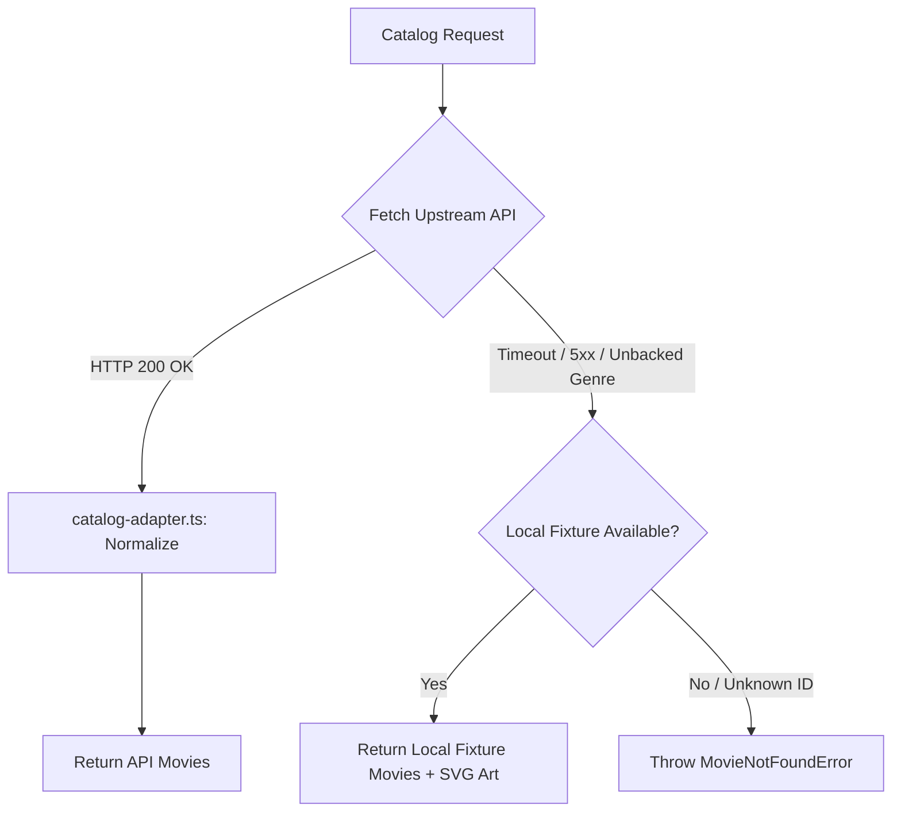

# Movie Discovery Platform — API Contract & Implementation

**Status:** Verified & Implemented
**Base URL:** `https://moviesapi.codingfront.dev`
**Adapter:** `src/features/catalog/catalog-adapter.ts`
**Service:** `src/features/catalog/catalog-service.ts`

This document defines the upstream API contract for the CodingFront Movies API and describes how the application adapts responses, normalizes data, and handles edge cases and fallbacks.

---

## 1. Verified Catalog Endpoints

| Purpose | Method and path | Observed response shape | Notes & Adapter Behavior |
|---|---|---|---|
| **List movies** | `GET /api/v1/movies?page={page}` | `{ data: MovieSummary[], metadata: PaginationMetadata }` | Paginated catalog list (15 movies per page). Returns metadata with `current_page`, `page_count`, and `total_count`. |
| **Search movies** | `GET /api/v1/movies?q={query}&page={page}` | `{ data: MovieSummary[], metadata: PaginationMetadata }` | Real-time movie search. Encoded with `URLSearchParams`. Falls back gracefully to matching local fixtures on network failure. |
| **Movie details** | `GET /api/v1/movies/{id}` | `MovieDetails` object | Single movie details by numeric ID. Poster may be an absolute URL or a filename; adapter resolves it to `https://moviesapi.codingfront.dev/images/**`. First image in `images[]` is parsed as landscape `backdropUrl`. |
| **Movies by genre** | `GET /api/v1/genres/{genre_name}/movies?page={page}` | `{ data: MovieSummary[], metadata: PaginationMetadata }` | Uses capitalized genre name in the path (`Drama`, `Action`, `Comedy`, etc.). Unbacked genres (e.g. `Documentary`) cleanly fall back to local fixtures. |
| **Genres** | `GET /api/v1/genres` | `Genre[]` | List of supported genres with movie counts. |

---

## 2. Normalized Application Types

The application converts raw API envelopes into a clean, defensive internal `Movie` domain model:

```ts
export interface Movie {
  id: string;
  title: string;
  year: number | null;
  rating: number | null; // 0–10 scale; null when unknown
  runtimeMinutes: number | null;
  genres: string[];
  synopsis: string | null;
  posterUrl: string | null;
  backdropUrl: string | null;
  art: readonly [string, string] | null; // Fallback gradient for fixtures
  director: string | null;
  actors: string | null;
  country: string | null;
  imdb_id: string | null;
  imdb_rating: number | null;
  website: string | null;
}
```

---

## 3. Resilient Fallback Architecture



1. **Network Timeouts & Failures:** Any upstream `fetch` failure or 5xx server error triggers the local fixture fallback layer.
2. **Fixture Artwork:** When displaying fixture movies (e.g. Documentary titles `quiet-reel` and `silent-cartographer`), SVG vector posters and high-resolution backdrop art are rendered dynamically via `PosterArt`.
3. **Remote Image Security:** `next.config.ts` explicitly restricts remote image optimization to `moviesapi.codingfront.dev` under `/images/**` to avoid open-proxy security risks.
