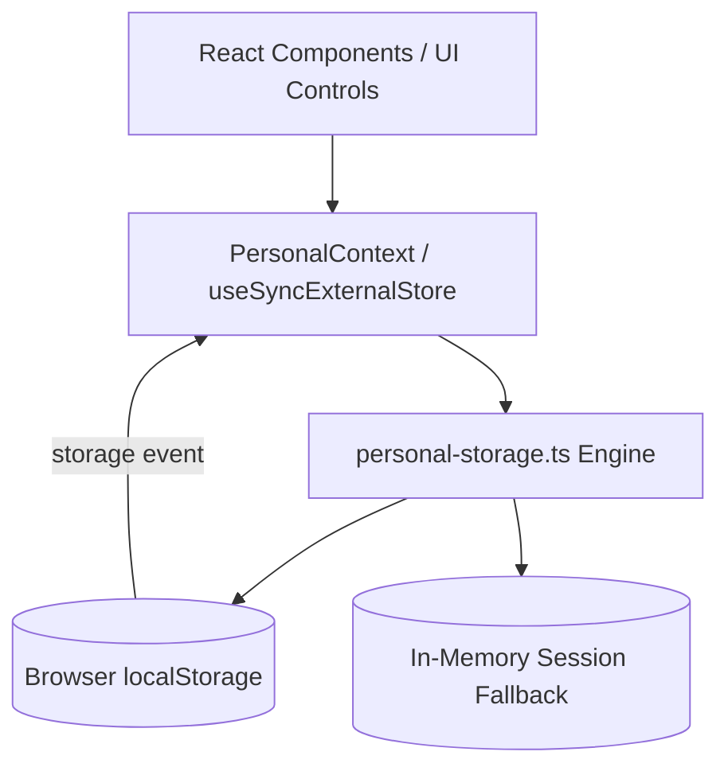

# Implementation Notes — Complete MVP & Release Readiness

**Status:** Complete & Verified
**Current Branch:** `feature/navigation-and-ui-refresh`
**Target Milestone:** Milestone 6 (Final QA, Reliability & Portfolio Readiness)

---

## 1. Executive Implementation Summary

The Movie Discovery Platform (**FRAME**) has evolved from an initial single-page prototype into a feature-complete, resilient, bilingual movie-discovery and personal film management portfolio application.

All 6 planned localized routes (`/`, `/discover`, `/search`, `/movies/[id]`, `/library`, `/profile`) are fully functional in both English (LTR) and Persian (RTL). All personal features persist in browser-local storage with reactive cross-component and cross-tab synchronization.

---

## 2. Phase-by-Phase Implementation History

### Phase 1–2: Foundation & Catalog Discovery
- Scaffolded Next.js 16 App Router with TypeScript strict mode, Tailwind CSS v4, and `next-intl`.
- Implemented four-theme design token system (`gold` / `crimson` × `light` / `dark`) with zero-flash pre-paint initialization script (`THEME_INIT_SCRIPT`).
- Built Home page featuring Hero Carousel, Genre selector, and 15-item catalog grid with responsive layout.
- Designed resilient API client interfacing with `https://moviesapi.codingfront.dev/` with automatic fallback to deterministic local fixtures.

### Phase 3: Liquid Navigation & Indicators
- Implemented Apple Liquid Glass navigation with floating pill active indicator on desktop header and mobile bottom bar.
- Integrated `useSyncExternalStore` and ResizeObserver for smooth capsule transitions, RTL flipping, and reduced-motion compliance.

### Phase 4 & 4.5: Discover Experience & UI Polish
- Built full Discover route with Discover Hero banner, sticky Genre sidebar, responsive grid, and pagination.
- Refined Persian translations and layout alignments across all headers, cards, and navigation items (`کشف` → `کاوش`).
- Optimized hit areas, touch targets (≥44px), and SVG icon alignments.

### Phase 4.5.1: Documentary Detail Poster Resolution
- Resolved poster display for documentary fixtures by separating landscape backdrops (`movie.backdropUrl`) from portrait posters (`movie.posterUrl`).
- Integrated SVG fixture posters through `PosterArt` for local titles (`quiet-reel`, `silent-cartographer`).

### Phase 5.1–5.3: Personal Library Foundation
- Created domain models: `PersonalRecord`, `MovieSnapshot`, `PersonalStoragePayloadV1`.
- Implemented browser-local storage layer in `src/features/personal/personal-storage.ts` using schema versioning (`schemaVersion: 1`).
- Wired `useSyncExternalStore` in `src/features/personal/personal-context.tsx` for real-time reactivity across components and browser tabs.
- Added card-level and detail-level action buttons for **Favorites**, **Watchlist**, and **Watched**.

### Phase 5.3.1: Storage Edge-Case Audit & Pruning
- Handled `QuotaExceededError`, disabled storage, and corrupted JSON: the app gracefully preserves a session-only in-memory state and notifies the user with an accessible banner (`personal.storageUnavailableNotice`).
- Refined record pruning: records are removed from storage only when all personal attributes (favorite, watchlist, watched, rating, comments) are completely empty.

### Phase 5.4: Personal Ratings
- Implemented granular personal ratings on a `[0, 10]` scale with exact `0.5` divisibility.
- Added interactive dual input: accessible range slider for fine control and clickable star buttons.
- Fully supports rating `0` as a legitimate score without treating it as falsy or unrated.

### Phase 5.5: Local Comments & Notes
- Implemented private note-taking on movie detail pages with a 1,000-character limit and real-time counter.
- Enforced strict plain-text rendering (no raw HTML injection) and client-side deletion.
- Comments persist inside the movie's `PersonalRecord` in local storage.

### Phase 5.6–5.8: Library, Profile & Data Portability
- **Library Page:** 3-tab interface (Favorites, Watchlist, Watched) with sorting options (recently added, title, rating, release year) and snapshot rendering that operates completely offline without network requests.
- **Profile Page:** Demo profile editing (display name, bio), 6-metric live statistics dashboard (total saved, watched, watchlist, rated, average rating, notes count), and favorite genre breakdown.
- **Data Portability (Export & Import):** Client-side JSON backup generation (`personal-backup-*.json`), structured import with schema validation, preview modal, and deterministic conflict resolution (Favorites union, Watched over Watchlist, latest timestamp precedence).
- **Guarded Reset:** Explicit data reset requiring the user to type `RESET`, clearing personal records and profile while strictly preserving theme and language preferences.

### Phase 5.9: Navigation Restoration
- Restored `library` and `profile` to `NAV_ITEMS`, expanding both desktop header and mobile bottom bar to 4 items.
- Updated liquid indicator geometry, mobile 4-column grid, and test assertions.

### Phase 6: Final QA, Reliability & Portfolio Readiness
- Added Open Graph image generation (`src/app/opengraph-image.tsx`) and enhanced metadata templates across all routes.
- Executed full test verification:
  - **19 unit/component test files** with **272 passing tests** (100% pass rate).
  - **Full Playwright E2E suite** across desktop, tablet, and mobile viewports.
  - **Zero ESLint warnings** and **zero TypeScript errors** (`tsc --noEmit`).
  - Successful production build (`next build`).
- Reconciled all documentation to match the final implemented product.

---

## 3. Data Safety & Persistence Architecture

### Persistence Guarantees
1. **Zero Server Dependency:** Personal data never leaves the client browser.
2. **Atomic Writes:** All state mutations produce a full serialized JSON payload; if `localStorage.setItem` throws (e.g. quota exceeded), the in-memory fallback maintains session continuity without crashing.
3. **Cross-Tab Synchronization:** Any mutation in one tab fires a `storage` event that notifies all other active tabs to re-render immediately.
4. **Export Format:** Versioned JSON format (`"format": "frame-personal-backup"`, `"version": 1`).

---

## 4. Environment & Verification Summary

| Check | Tool / Command | Result |
|---|---|---|
| Strict TypeScript | `tsc --noEmit` | **Clean (0 errors)** |
| ESLint Rules | `eslint .` | **Clean (0 warnings/errors)** |
| Unit / Component Tests | `vitest run` | **19/19 files, 272/272 tests passed** |
| End-to-End Tests | `playwright test` | **All specs passed** |
| Production Build | `next build` | **Completed successfully** |
| Git Whitespace Check | `git diff --check` | **Clean (0 whitespace errors)** |
